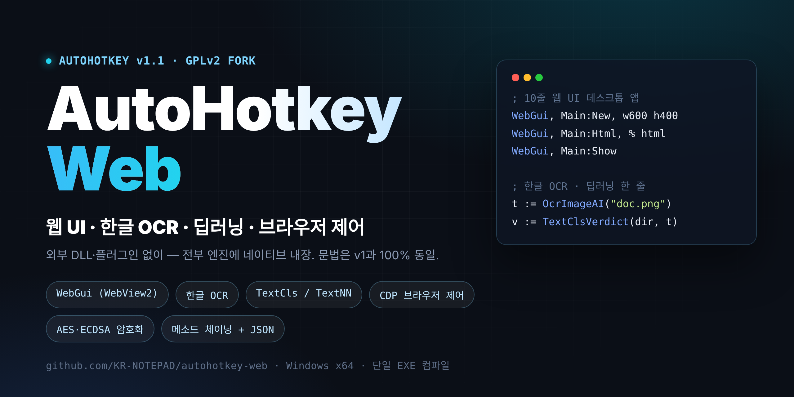
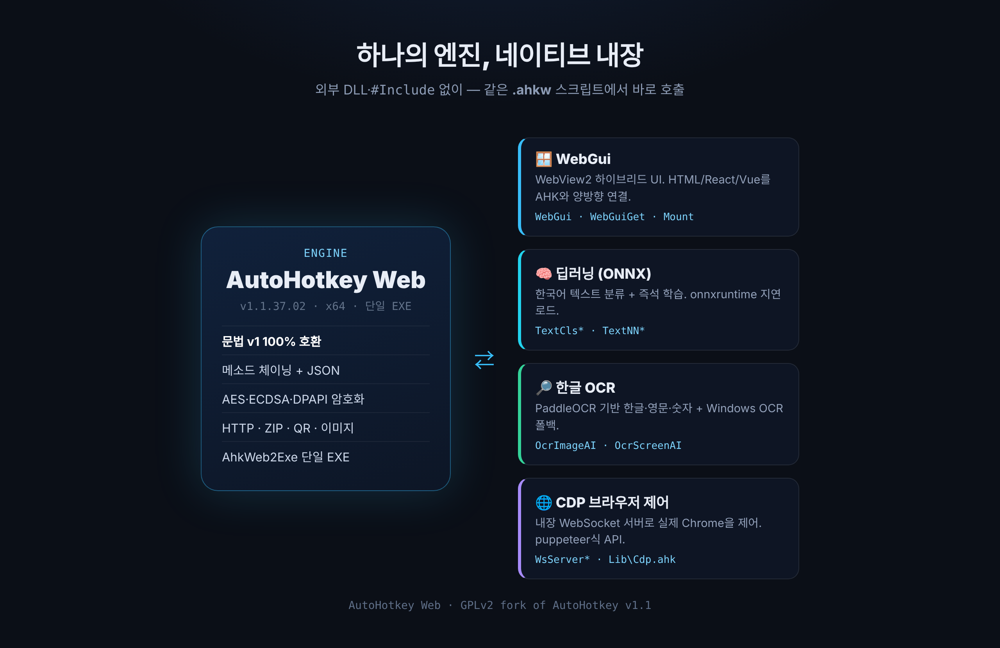

<p align="center">
  
</p>

<h1 align="center">AutoHotkey Web</h1>

<p align="center">
  <b>웹 UI · 한글 OCR · 딥러닝 · CDP 브라우저 제어를 전부 엔진에 네이티브 내장한 AutoHotkey v1.1 포크</b><br>
  <sub>A hybrid-web, Korean-OCR, on-device deep-learning fork of AutoHotkey v1.1 — no external DLL, syntax 100% compatible.</sub>
</p>

<p align="center">
  <a href="LICENSE"></a>
  
  
  
  
  <a href="https://github.com/KR-NOTEPAD/autohotkey-web"></a>
</p>

<p align="center">
  <a href="#-빠른-시작">빠른 시작</a> ·
  <a href="#-주요-기능">주요 기능</a> ·
  <a href="#-vs-stock-autohotkey-v11">무엇이 다른가</a> ·
  <a href="#-문서">문서</a> ·
  <a href="#-빌드">빌드</a> ·
  <a href="#-라이선스">라이선스</a>
</p>

---

**AutoHotkey Web**은 [AutoHotkey v1.1.37.02](https://github.com/AutoHotkey/AutoHotkey)를 포크한 독립 실행 엔진입니다.
**문법은 v1과 100% 동일**하고, 기존 `.ahk` 스크립트가 그대로 돌아갑니다. 거기에 웹 하이브리드 UI,
한국어 AI(OCR·텍스트 분류), 브라우저 자동화, 암호화 툴킷, 메소드 체이닝을 **외부 DLL·`#Include` 없이 엔진에 직접 내장**했습니다.

> **빌드** `A_AhkWebBuild` = 2026.11.1 · 엔진 1.1.37.02 · [CHANGELOG](CHANGELOG.md)  
> **범위** 합법적인 자동화·개발 용도 기능만 포함합니다. 민감(포렌식/복구) 기능은 포함하지 않습니다 → [SECURITY.md](SECURITY.md)

<br>

## ⚡ 빠른 시작

```bat
REM 1) 설치: 설치 프로그램 실행 (엔진·컴파일러·문서·.ahkw 연결·SciTE4 자동 구성)
installer\output\AutoHotkeyWeb_Setup_1.1.37.02.exe

REM 2) 실행
AutoHotkeyWeb.exe myapp.ahk

REM 3) 단일 EXE로 컴파일 (엔진+스크립트+웹자산이 .exe 하나)
compiler\AhkWeb2Exe.exe /in myapp.ahk /out myapp.exe /icon myapp.ico
REM    인자 없이 실행하면 Ahk2Exe처럼 GUI (스크립트·출력·아이콘·버전 정보, 드래그&드롭)
compiler\AhkWeb2Exe.exe
```

컴파일 지시어도 Ahk2Exe와 같은 방식으로 씁니다 (`;@Ahk2Exe-` 또는 `;@AhkWeb-`, GUI/명령줄 값보다 우선):

```autohotkey
;@Ahk2Exe-SetMainIcon app.ico          ; exe·트레이 아이콘 교체
;@Ahk2Exe-SetVersion 1.2.3.4           ; 파일/제품 버전
;@Ahk2Exe-SetDescription 내 프로그램
;@Ahk2Exe-SetCopyright (c) 2026 Me
;@Ahk2Exe-SetCompanyName / SetProductName / SetOrigFilename / SetInternalName / SetName
;@Ahk2Exe-Set Comments, 임의 속성도 가능
;@Ahk2Exe-AddResource pause.ico, 207   ; 아이콘 그룹 교체(206 Suspend·207 Pause·208 둘 다) 또는 기타 리소스
;@Ahk2Exe-ExeName %A_ScriptDir%\dist\MyApp
;@AhkWeb-Assets web                    ; 웹 자산 폴더 내장
```

설치하면 **우클릭 → 새로 만들기 → "AutoHotkey Web Script"**(`.ahkw`, 한글 UTF-8 BOM 템플릿)가 생기고,
SciTE4에서 구문 강조·F5 실행·F7 디버그·Ctrl+F7 컴파일·자동완성이 자동 구성됩니다.

<br>

## ✨ 주요 기능

### 🪟 WebGui — 웹 기술로 데스크톱 UI
WebView2 기반 하이브리드 UI. HTML/CSS/JS(React·Vue 등)를 띄우고 AHK와 양방향으로 연결합니다.

```autohotkey
WebGui, Main:New, w600 h400 Center, 내 앱
WebGui, Main:Expose, SayHello          ; JS → AHK 함수 노출
WebGui, Main:Html, % "<button onclick='ahk.SayHello(``Chris``)'>click</button>"
WebGui, Main:Show
return
SayHello(name) {
    WebGui, Main:Eval, % "alert('안녕 " name "')"   ; AHK → JS
}
```

### 🔎 한글 OCR — 한 줄
PaddleOCR 기반 한글·영문·숫자 인식(`OcrImageAI`/`OcrScreenAI`) + Windows 내장 OCR 폴백.

```autohotkey
text := OcrImageAI("receipt.png")        ; 이미지에서 한글 추출
text := OcrScreenAI(0, 0, 800, 600)      ; 화면 영역에서 바로
```

### 🧠 딥러닝 — 분류 + 즉석 학습 (ONNX)
사전학습 모델로 한국어 텍스트를 분류하거나, 백본 + MLP 헤드를 **즉석에서 학습**합니다.

```autohotkey
v := TextClsVerdict(modelDir, "이 리뷰 악성인가요?")   ; "판정,라벨,악성%,정상%"
TextNNTrain(backbone, "data.tsv", "model.ntc")         ; 즉석 학습
r := TextNNClassify("model.ntc", "분류할 문장")         ; "라벨,확률;..."
```

### 🌐 CDP — 실제 Chrome 제어
엔진 내장 WebSocket 서버 + 번들 `Lib\Cdp.ahk`. 드라이버/디버깅 포트 없이 열려 있는 크롬에 붙습니다. puppeteer/jQuery식 API.

```autohotkey
#Include %A_ScriptDir%\Lib\Cdp.ahk
cdp := new Cdp()
tab := cdp.open("https://news.ycombinator.com")
MsgBox % tab.evaluate("document.title")
tab.q("input[name=q]").val("autohotkey").focus()        ; jQuery식 체이닝
```

### 🔗 메소드 체이닝 + JSON · 🔐 암호화
문자열·배열·객체 체이닝, JSON, 해시·AES-GCM·ECDSA·DPAPI를 전부 내장 함수로.

```autohotkey
out := "  사과,바나나,체리 ".Trim().Split(",").Map("StrUpper").Join(" | ")
top := [5,3,9,1].Sort("N").Reverse()[1]                 ; 9
obj := JsonParse(HttpGet("https://api.example.com/x"))  ; 체이닝과 바로 연결
enc := EncryptPassword("secret", "p@ss")  /  sig := EcdsaSign(priv, "msg")
```

<br>

## 🧩 아키텍처

<p align="center">
  
</p>

<br>

## 🆚 vs stock AutoHotkey v1.1

| 항목 | stock | AutoHotkey Web |
|---|---|---|
| 웹 UI | — | **`WebGui` / `WebGuiGet`** (WebView2 하이브리드, `Mount`/`Eval`/`DevTools`) |
| AI 텍스트 | — | **`TextCls*` / `TextNN*`** (ONNX 분류 + 즉석 학습) |
| 한글 OCR | — | **`OcrImageAI` / `OcrScreenAI`** (PaddleOCR) + Windows OCR |
| 브라우저 제어 | — | **`WsServer*` + `Lib\Cdp.ahk`** (CDP, 확장 브리지) |
| 암호화 | — | SHA/HMAC, AES-256-GCM, PBKDF2, DPAPI, ECDSA, 보안 난수 |
| 툴킷 | — | HTTP·병렬요청·ZIP·QR·이미지서치·CSV·문자열 유사도 약 150종 |
| 메소드 체이닝 | — | 문자열·배열·객체 체이닝 + `JsonParse`/`JsonStringify` |
| 단일 EXE | Ahk2Exe | **AhkWeb2Exe** (웹자산 내장 `;@AhkWeb-Assets`, 스크립트 난독·압축 `AHKW1`) |
| 창 클래스(컴파일 exe) | `AutoHotkey` | `AhkwShell` (중립 식별자, 안티치트 오탐 완화) |
| 추가 변수 | — | `A_AhkWebVersion` · `A_IsAhkWeb` · `A_AhkWebAssets` · `A_AhkWebBuild` |

> 기존 `.ahk`와 **공존**합니다 — 창 클래스·레지스트리(`SOFTWARE\AutoHotkeyWeb`)·컴파일 마커(`>AHKWEB SCRIPT<`)가 분리되어 stock 설치를 건드리지 않습니다.

<br>

## 📚 문서

- 로컬: `docs/index.htm`를 브라우저로 열기
- CHM 생성: `"%ProgramFiles(x86)%\HTML Help Workshop\hhc.exe" docs\AutoHotkeyWeb.hhp` → SciTE4 F1 연결
- 예제: [`examples/`](examples/) — 딥러닝 분류·CDP·딥러닝 학습·한글 OCR·암호화·메소드 체이닝·HTTP/ZIP/QR (전부 네이티브, 바로 실행)

<br>

## 🔨 빌드

```bat
REM 최초 1회: WebView2 SDK 받기
powershell -ExecutionPolicy Bypass -File fetch_webview2.ps1

REM 엔진 빌드 (x64 Native Tools Command Prompt for VS 2022)
build.bat
REM → engine_src\bin\AutoHotkeyU64.exe → 루트 AutoHotkeyWeb.exe

REM Self-contained 베이스 + 컴파일러
cd compiler && build_compiler.bat
```

- ONNX Runtime이 없으면 `build.bat`이 자동 감지해 AI 기능을 스텁으로 끄고 빌드합니다(`/p:EnableOnnx=false`). 나머지 기능은 정상.
- Google Drive 경로에서 빌드 시 `IntDir`을 로컬(`C:\ahkweb_build`)로 지정하세요(동기화가 `.ipdb`를 잠가 LNK1257 방지).
- 설치 프로그램 재빌드: `installer\build_installer.bat` (Inno Setup 6).

<br>

## ✅ 검증 상태

실제 실행으로 확인된 항목(요약):

- 엔진 Release|x64 + Self-contained 빌드·실행, 단일 EXE 컴파일·실행
- `WebGui` 창 생성 → HTML 로드 → JS↔AHK 양방향, `Mount`(ES 모듈/fetch), `WebGuiGet Eval/Hwnd`
- 딥러닝: `onnxruntime.dll` 지연 로드, 분류(`kor_unsmile`) 정상→`선`0.0055 / 악성→`악`0.9874, 학습 라운드트립
- CDP: `WsServer*` 기동·포트, `JsonGet`, 번들 `Cdp.ahk` 외부 `#Include` 없이 로드
- 툴킷/체이닝 자체 테스트 `tests\features\ext_chain_test.ahk` **87/87 통과**

<br>

## 📦 배포물

- 설치 프로그램 `AutoHotkeyWeb_Setup_1.1.37.02.exe` (모델 선택 구성요소) — [Releases](https://github.com/KR-NOTEPAD/autohotkey-web/releases)에서 배포
- 모델(OCR·분류·백본, ≈230MB)은 용량상 리포에 넣지 않고 Releases로 제공 → [MODELS.md](MODELS.md)

<br>

## 📄 라이선스

**GPLv2** (AutoHotkey v1.1 포크). 바이너리(AhkWeb2Exe로 컴파일한 exe 포함)를 배포하면 대응 소스를 GPLv2로 공개해야 합니다. 전문은 [LICENSE](LICENSE).

- **서드파티:** ONNX Runtime(MIT), WebView2 Loader(BSD-3-Clause), miniz·cJSON·qrcodegen(MIT)
- **모델:** kor_unsmile(Apache-2.0), KoSimCSE(CC BY-SA 4.0), PP-OCRv5(Apache-2.0) — 출처·조건 [MODELS.md](MODELS.md)
- **상표:** "AutoHotkey"는 원 상표권자의 상표이며, 본 포크는 원 프로젝트와 **무관(not affiliated)**합니다.

<p align="center"><sub>Fork of AutoHotkey v1.1 · GPLv2 · 본 README는 홍보/소개용이며 법률 자문이 아닙니다.</sub></p>
